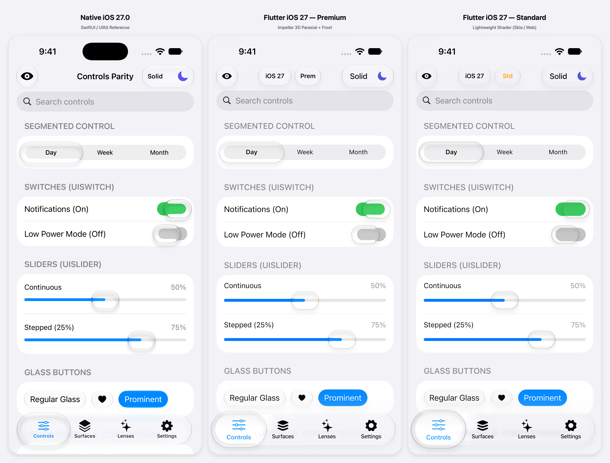
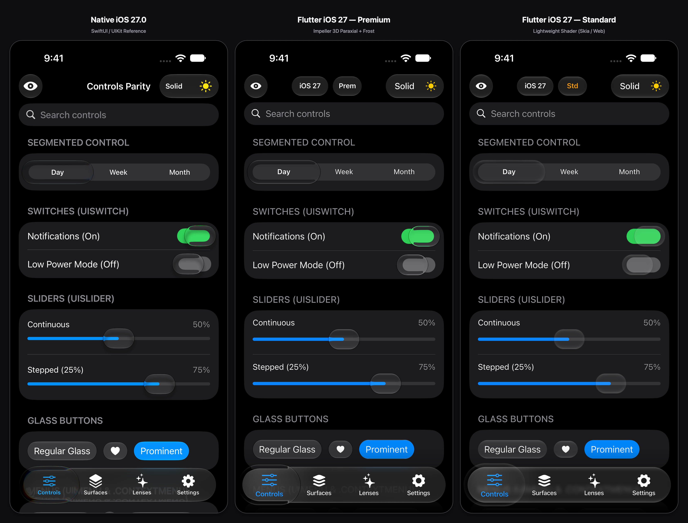

<div align="center">

# Liquid Glass Widgets

Bring Apple's Liquid Glass to your Flutter app — supporting both **iOS 27** and **iOS 26** materials — with real shader-based refraction, physics-driven liquid morphing, and dynamic lighting across every platform.

[](https://pub.dev/packages/liquid_glass_widgets)
[](https://pub.dev/packages/liquid_glass_widgets/score)
[](https://pub.dev/packages/liquid_glass_widgets/score)
[](https://github.com/sdegenaar/liquid_glass_widgets/actions/workflows/ci.yml)
[](https://codecov.io/gh/sdegenaar/liquid_glass_widgets)
[](https://opensource.org/licenses/MIT)

<br>


<br>


</div>


## Installation

```yaml
dependencies:
  liquid_glass_widgets: ^1.17.4
```

```bash
flutter pub get
```

> **Requirements:** Flutter ≥ 3.41.0 (Dart ≥ 3.5.0).


## Quick Start

Two steps — that's the entire setup:

**Step 1.** Call `LiquidGlassWidgets.initialize()` in `main()` to preload shader bytecode from disk to RAM asynchronously without GPU rasterization before `runApp()` (customizable via `warmUpMode` and `enablePerformanceMonitor`).

**Step 2.** Wrap your app with `LiquidGlassWidgets.wrap()`:

```dart
import 'package:flutter/cupertino.dart';
import 'package:liquid_glass_widgets/liquid_glass_widgets.dart';

void main() async {
  WidgetsFlutterBinding.ensureInitialized();
  await LiquidGlassWidgets.initialize();

  runApp(LiquidGlassWidgets.wrap(child: const MyApp()));
}
```

> **Using `MaterialApp`?** Pass `brightnessResolver: Theme.maybeBrightnessOf` so glass widgets honour your `ThemeMode` instead of the raw OS brightness:
> ```dart
> runApp(LiquidGlassWidgets.wrap(
>   child: const MyApp(),
>   brightnessResolver: Theme.maybeBrightnessOf, // ← required for MaterialApp
> ));
> ```
>
> **Migrated to `package:cupertino_ui` on Flutter 3.50+?** Add Flutter's compatibility bridge to your `CupertinoApp` (`builder: (context, child) => CupertinoUiCompatibilityBridge(child: child!)`) so `CupertinoTheme` and localizations propagate into SDK-Cupertino packages.

Then use `GlassScaffold` on each screen — it handles the background, status bar, z-ordering, bar isolation, and scroll edge fading automatically:

```dart
GlassScaffold(
  background: Image.asset('assets/wallpaper.jpg', fit: BoxFit.cover),
  statusBarStyle: GlassStatusBarStyle.auto,
  appBar: GlassAppBar(title: const Text('My App')),
  bottomBar: GlassTabBar.bottom(
    selectedIndex: 0,
    onTabSelected: (i) {},
    tabs: const [
      GlassTab(icon: Icon(CupertinoIcons.slider_horizontal_3), label: 'Controls'),
      GlassTab(icon: Icon(CupertinoIcons.square_stack_3d_up_fill), label: 'Surfaces'),
    ],
  ),
  body: CustomScrollView(slivers: const []),
)
```

### Choose the Right Surface

| Scenario | Widget to use |
|---|---|
| Screen with app bar and/or tab bar | **`GlassScaffold`** — primary pattern (handles background, bars, isolation, edge fading) |
| Custom layout without a standard scaffold | **`GlassPage`** — lower-level screen wrapper |
| Inset-grouped Settings / form cards | **`GlassGroupedSection(surfaceStyle: GlassSurfaceStyle.solid)`** with `GlassListTile` |
| Standalone floating glass panel | **`GlassContainer.card` / `GlassContainer`** |
| Localised group of glass elements | **`AdaptiveLiquidGlassLayer`** — shares layer settings across children |


## AI Coding & Vibecoding Support

Building with **Antigravity**, **Cursor**, **Claude Code**, or **GitHub Copilot**?
Install the official skill to help your agent use the current `1.17.x` APIs instead of hand-rolled `BackdropFilter` stacks:

- **Antigravity / Gemini CLI**:
  ```bash
  mkdir -p .agents/skills/liquid-glass-widgets
  curl -sSL https://raw.githubusercontent.com/sdegenaar/liquid_glass_widgets/main/skills/liquid-glass-widgets/SKILL.md -o .agents/skills/liquid-glass-widgets/SKILL.md
  ```
- **Cursor**: Copy [`skills/liquid-glass-widgets/SKILL.md`](skills/liquid-glass-widgets/SKILL.md) to `.cursor/rules/liquid-glass.mdc`.
- **Claude Code**: Add [`skills/liquid-glass-widgets/SKILL.md`](skills/liquid-glass-widgets/SKILL.md) to `.claude/skills/liquid-glass-widgets/SKILL.md` or `CLAUDE.md`.
- **Details & Other IDEs**: See [`skills/README.md`](skills/README.md).


## Features

- **Unified `GlassStyle` System (`ios27` & `ios26`)** — Defaults to `GlassStyle.ios27` (`LiquidGlassSettings.ios27Light` / `ios27Dark` and `ios27Indicator`), or switch your entire app to iOS 26 (`const GlassThemeData.ios26()`) in one line.
- **iOS 27 & 26 Optical Modelling (best effort)** — Calibrated against native iOS on a best-effort basis: paraxial lens refraction (`GlassLensModel.paraxial`), luminance-weighted frost, directional `rimShade` perimeter hairlines, `rimLight` specular lobes, and tab-bar platter pinch with chromatic icon dispersion on Impeller (`GlassQuality.premium`), plus a lighter single-pass `GlassQuality.standard` shader for Skia, Web, and dense scrolling lists.
- **Liquid Morph Engine** — Standalone spring-physics system powering native teardrop morphing for `GlassMenu`, `GlassPullDownButton`, `GlassPopover`, and `GlassModalSheet.show(morphFrom:)`. See [`docs/LIQUID_MORPH_ENGINE.md`](docs/LIQUID_MORPH_ENGINE.md).
- **Pinned Navigation Chrome & Bezel Transitions** — `GlassNavigationShell` morphs pinned bar items across routes, `GlassBarItem.spacer()` splits and merges capsules like SwiftUI's `ToolbarSpacer(.fixed)`, and `GlassPageTransitionsBuilder` clips transitioning pages to the active iPhone display-bezel superellipse. See [`docs/GLASS_NAVIGATION_TRANSITION.md`](docs/GLASS_NAVIGATION_TRANSITION.md).
- **Native List & Form Patterns** — `GlassListTile`, `GlassSwipeActions`, `GlassReorderableList` with `GlassEditScope` / `GlassEditButton`, `GlassDisclosureGroup`, `GlassContextMenu`, `GlassFullScreenCover`, and `GlassDatePicker` (`.compact` / `.graphical` / `.wheel`), plus `GlassSurfaceStyle.solid` for zero-shader inset-grouped cards.
- **Cross-Platform & Zero External Dependencies** — Runs on iOS, Android, macOS, Web, Windows, and Linux using only the pure Flutter SDK (`flutter: sdk: flutter`).
- **Accessibility, Keyboard & RTL Support** — Reads Reduce Motion and Increase Contrast, supports iOS On/Off switch labels (`I`/`O`), keyboard Tab/Space/Enter focus, VoiceOver/TalkBack semantics, and RTL layouts.


## Native iOS 27 Comparison — `Premium` vs. `Standard`

Controls and navigation surfaces are tuned toward native iOS 27 (`UIKit` / `SwiftUI`) on a best-effort basis. Neither tier is pixel-identical to native:

- **`GlassQuality.premium` (Impeller)**: Backdrop refraction, chromatic dispersion across the curved lens bevel, luminance-weighted frost. `GlassSwitch`, `GlassSlider` and `GlassSegmentedControl` mount their lens shader only while pressed or dragged.
- **`GlassQuality.standard` (lightweight shader — Skia / Web / dense lists)**: An approximation using meniscus rim absorption, directional `rimLight` and perimeter hairline contours. Its interactive indicator lenses apply no backdrop blur, and refraction is limited to an optional background source (see [Optional Wallpaper Refraction](#optional-wallpaper-refraction-on-skia-and-web)), so they will not refract arbitrary content behind the lens the way `premium` does.

<div align="center">

**Light Mode — Lifted Lenses (`Native iOS 27.0` vs. `Flutter Premium` vs. `Flutter Standard`)**



<br><br>

**Dark Mode — Lifted Lenses (`Native iOS 27.0` vs. `Flutter Premium` vs. `Flutter Standard`)**



<br>

<sub>Simulator captures of a comparison harness (the top bar differs by column because it is harness chrome). Visible differences remain, for example the Standard switch thumb and the tab-bar lens bevel. Results vary by device, OS version and content behind the glass.</sub>

</div>


## Glass vs. Content — Design Philosophy

In iOS 26 and iOS 27, **glass is reserved for the floating navigation and control layer** above your content, while scrolling content cards and list rows stay opaque:

| ✅ Use glass for | ❌ Keep opaque (`GlassSurfaceStyle.solid`) |
|---|---|
| Navigation bars (`GlassAppBar`), tab bars (`GlassTabBar`), toolbars (`GlassToolbar`) | Inset-grouped list cards (`GlassGroupedSection`, `GlassContainer.card`) |
| Floating action buttons (`GlassButton`, `GlassIconButton`, `GlassPullDownButton`) | List rows (`GlassListTile`), article tiles, media cells |
| Sheets, dialogs, popovers, menus (`GlassModalSheet`, `GlassDialog`, `GlassMenu`) | Form input wells inside solid cards (auto-inherited) |
| Active lifted lenses (`GlassSwitch`, `GlassSlider`, `GlassSegmentedControl`) | Full-screen backgrounds |

### Glass Composition Rule: Glass is a Platter, Not a Wrapper

`GlassContainer.card`, `GlassContainer`, and `GlassGroupedSection` are **base surfaces** — do not nest persistently refractive glass widgets (`GlassButton`, `GlassChip`) inside a `glass`-mode container (nested glass sets `avoidsRefraction: true` to prevent double-refraction artifacts).

For Settings screens and scrolling lists, pass `surfaceStyle: GlassSurfaceStyle.solid` to render a flat white (`#FFFFFF`) / dark (`#1C1C1E`) card with 26 pt continuous corners and zero shader cost (`glass` is the 1.x default; `solid` becomes the default in `2.0.0`). Form inputs (`GlassTextField`, `GlassSearchBar`, `GlassTextArea`, `GlassPasswordField`, `GlassPicker`, `GlassChip`) **automatically inherit `GlassSurfaceStyle.solid`** when placed inside a solid section or card, while `GlassSwitch`, `GlassSlider`, and `GlassSegmentedControl` keep their full `premium` lifted lens when touched:

```dart
GlassGroupedSection(
  surfaceStyle: GlassSurfaceStyle.solid,
  header: const Text('NETWORK'),
  children: [
    GlassListTile(
      title: const Text('Wi-Fi'),
      trailing: GlassSwitch(value: _wifi, onChanged: (v) => setState(() => _wifi = v)),
    ),
  ],
)
```


## Widget Categories

### Containers
`GlassContainer.card` · `GlassContainer` · `GlassDivider` · `GlassGroupedSection` · `GlassListTile` · `GlassStepper` · `GlassSwipeActions` · `GlassDisclosureGroup` · `GlassReorderableList`

### Interactive
`GlassButton` · `GlassIconButton` · `GlassChip` · `GlassSwitch` · `GlassSlider` · `GlassSegmentedControl` · `GlassPullDownButton` · `GlassButtonGroup` · `GlassBadge` · `GlassPageControl` · `GlassEditButton`

### Input
`GlassTextField` · `GlassTextArea` · `GlassPasswordField` · `GlassSearchBar` · `GlassPicker` · `GlassFormField` · `GlassDatePicker` (`.compact` / `.graphical` / `.wheel`) · `GlassMultiDatePicker`

### Feedback
`GlassProgressIndicator` · `GlassToast`

### Overlays
`GlassDialog` · `GlassSheet` · `GlassModalSheet` · `showGlassActionSheet` · `GlassMenu` · `GlassMenuItem` · `GlassMenuDivider` · `GlassMenuLabel` · `GlassPopover` · `GlassContextMenu` · `GlassFullScreenCover`

### Surfaces & Navigation
`GlassScaffold` · `GlassPage` · `GlassAppBar` · `GlassTabBar` (`.bottom` / `.inline` / `.searchable` / `.minimizable`) · `GlassTabBarTrailingButton` · `GlassToolbar` · `GlassNavigationShell` · `GlassNavigationStack` · `GlassNavigationLink` · `GlassPinnedBarChrome` · `GlassContentAwareScope` · `GlassContentAwareContent` · `GlassContentAwareBrightness`

### Effects
`GlassMaterialize` · `GlassMaterializeTransition` · `ProgressiveBlur`


## Theming & `GlassStyle` Presets

By default, all widgets use **`GlassStyle.ios27`**. You can switch the global era preset or customize light/dark variants in `LiquidGlassWidgets.wrap()`:

```dart
runApp(LiquidGlassWidgets.wrap(
  child: const MyApp(),
  // Built-in era presets:
  theme: const GlassThemeData.ios27(),   // default — iOS 27 paraxial lens & frost
  // theme: const GlassThemeData.ios26(), // iOS 26 directional rim & refraction
));
```

To customize specific parameters while keeping widget defaults for everything else, use `GlassThemeVariant` with `GlassThemeSettings` (all fields are nullable overrides):

```dart
runApp(LiquidGlassWidgets.wrap(
  child: const MyApp(),
  theme: const GlassThemeData(
    style: GlassStyle.ios27,
    light: GlassThemeVariant(
      settings: GlassThemeSettings(blur: 8),
      glowColors: GlassGlowColors(primary: CupertinoColors.activeBlue),
    ),
    dark: GlassThemeVariant(
      settings: GlassThemeSettings(blur: 10),
    ),
  ),
));
```

**Three-level override hierarchy (highest wins):**
1. **Widget `settings:` / `quality:` parameter** — explicit per-widget override
2. **`GlassPage(themeOverride: ...)` or local `GlassTheme`** — per-screen / subtree override
3. **`LiquidGlassWidgets.wrap(theme: ...)`** — app-wide default

### Specular Sharpness (`GlassSpecularSharpness`)

Control specular highlight tightness on any `LiquidGlassSettings` or `GlassThemeSettings` (implemented as a fixed multiply chain rather than `pow()`):
- `GlassSpecularSharpness.soft` — wide, diffuse matte sheen
- `GlassSpecularSharpness.medium` — **default** balanced highlight
- `GlassSpecularSharpness.sharp` — tight, mirror-like edge highlight


## Glass Quality Modes

| Mode | Renderer | When to use |
|---|---|---|
| **`GlassQuality.standard`** | Lightweight 2D fragment shader (all platforms) | **Default for body widgets** (`GlassButton`, `GlassContainer.card`, scrollable content, Skia/Web). Single-pass shader that avoids the premium multi-pass pipeline. |
| **`GlassQuality.premium`** | Full Impeller 3D paraxial/refraction + blur + frost | **Default for floating chrome, overlays & active lenses** (`GlassAppBar`, `GlassTabBar`, `GlassDialog`, `GlassMenu`, `GlassModalSheet`, `GlassSwitch`, `GlassSlider`, `GlassSegmentedControl` in `ios27`/`ios26`). Falls back to `standard` on Skia/Web. |
| **`GlassQuality.minimal`** | Shader-free `BackdropFilter` + Rec. 709 saturation + rim stroke | No custom fragment shader — useful for GPU budget management on dense lists or hardware without shader filter support. |

### Optional Wallpaper Refraction on Skia and Web

By default, `GlassQuality.standard` does not capture a background texture unless you provide a background source. On Skia and Web, interactive indicator lenses (`GlassSegmentedControl`, `GlassTabBar`) can optionally sample and refract a wallpaper image:
- **Recommended (`GlassScaffold` / `GlassPage`)**: Passing `background:` wires `LiquidGlassScope` and `GlassBackgroundSource` automatically.
- **Manual (`LiquidGlassScope` + `GlassBackgroundSource`)**: For custom non-`GlassPage` layouts, wrap the section in `LiquidGlassScope` and mark the background widget:
  ```dart
  LiquidGlassScope(
    child: Stack(
      children: [
        Positioned.fill(child: GlassBackgroundSource(child: Image.asset('assets/wallpaper.jpg'))),
        Center(
          child: GlassSegmentedControl(
            segments: const [GlassSegment(label: 'Day'), GlassSegment(label: 'Week')],
            selectedIndex: 0,
            onSegmentSelected: (i) {},
            quality: GlassQuality.standard,
          ),
        ),
      ],
    ),
  )
  ```


## `GlassScaffold` & Navigation Chrome

`GlassScaffold` wires up the background source, glass layer, bar isolation (`GlassIsolationScope`), scroll edge fade (`GlassScrollEdgeEffect`), and safe-area padding in a single widget.

### Scroll-to-Minimize (`GlassTabBar.minimizable`)

Matches SwiftUI's `.tabBarMinimizeBehavior(_:)`, shrinking the bottom tab bar into the selected tab's circle on scroll and expanding when scrolling back to the top or tapping the minimized pill:

```dart
final _scroll = ScrollController();
final _minimize = GlassTabBarMinimizeController(
  behavior: GlassBarMinimizeBehavior.onScrollDown, // .automatic, .never, .onScrollUp
);

@override
Widget build(BuildContext context) => GlassScaffold(
  body: ListView.builder(controller: _scroll, ...),
  bottomBar: GlassTabBar.minimizable(
    tabs: _tabs,
    selectedIndex: _index,
    onTabSelected: (i) => setState(() => _index = i),
    minimizeController: _minimize,
    scrollController: _scroll,
    onMinimizedTabTap: _minimize.expand,
  ),
);
```

> See [`example/lib/demos/minimizable_bar_demo.dart`](example/lib/demos/minimizable_bar_demo.dart) for `bottomAccessory` placement (`GlassTabBarAccessoryPlacementScope`) and `NotificationListener<ScrollNotification>` integration.

### Content-Aware Brightness

Glass bars can automatically flip between light and dark icons/labels based on the luminance of content scrolling behind them using WCAG contrast ratios with dual-threshold hysteresis:

```dart
GlassScaffold(
  contentAwareBrightness: true,
  bottomBar: GlassTabBar.bottom(
    adaptiveBrightness: true,
    tabs: _tabs,
    selectedIndex: _index,
    onTabSelected: (i) => setState(() => _index = i),
  ),
  body: CustomScrollView(slivers: [...]),
)
```

### Lower-Level Building Block: `GlassPage`

Use `GlassPage` directly only when you need a custom `Stack` or non-standard bar layout without `GlassScaffold`:

```dart
GlassPage(
  background: Image.asset('assets/wallpaper.jpg', fit: BoxFit.cover),
  edgeToEdge: true,
  statusBarStyle: GlassStatusBarStyle.auto,
  child: Scaffold(
    appBar: GlassAppBar(title: const Text('Custom Layout')),
    body: const MyContent(),
  ),
)
```


## Platform Support

| Platform | Renderer | Notes |
|---|---|---|
| **iOS** | Impeller (Metal) | Full 16-shape shader pipeline, chromatic aberration, precompiled AOT (`.metallib`) |
| **Android (Vulkan)** | Impeller (Vulkan) | Full 16-shape shader pipeline, chromatic aberration, async preloaded bytecode — same shader path as iOS Metal |
| **Android (GLES fallback)** | Impeller (GLES) | GLES-optimized 8-shape shader intended to reduce runtime driver compile stalls |
| **macOS** | Impeller (Metal) | Full 16-shape shader pipeline, chromatic aberration, precompiled AOT (`.metallib`) |
| **Web** | CanvasKit | Lightweight 2D fragment shader (`GlassQuality.standard`) |
| **Windows** | Impeller (ANGLE) / Skia | Lightweight 2D shader default; shader preload is asynchronous so it doesn't block the first frame |
| **Linux** | Impeller / Skia | Lightweight 2D shader default |


## Performance & Backdrop Grouping

1. **Shared Backdrop Reads (`GlassBackdropGroup`)**: On Impeller, every `BackdropFilter` copies the framebuffer. `GlassAppBar` and `GlassTabBar` automatically wrap their own items in a `GlassBackdropGroup` (`groupBackdrop: true`) so multiple buttons share a single backdrop capture (like SwiftUI's `GlassEffectContainer`). Wrap custom side-by-side glass toolbars in `GlassBackdropGroup(child: Row(...))` to share one read across all buttons.
   - *Grouping caveats*: Glass in the same group does not refract other members of that group when overlapping (opt out overlapping overlays with `GlassBackdropGroup(enabled: false, ...)`). Surfaces under `Opacity` / `FadeTransition` / `AnimatedOpacity`, nested inside glass, or using a visible `LiquidGlassSettings.backerColor` stay out of the group automatically. Wrap a single screen's bars rather than a `Navigator` or offstage tab stack.
2. **Lazy-Mounted Interactive Lenses**: `GlassSwitch`, `GlassSlider`, and `GlassSegmentedControl` render as lightweight widgets at rest (`0` shader layers) and mount their `premium` refractive lens shader only during active touch or drag.
3. **Automatic Quality Adaptation (`adaptiveQuality: true`, `@experimental`)**: `GlassAdaptiveScope` benchmarks raster frame times and steps quality down (`premium` → frost-off `frostStep` → `standard` → `minimal`) under thermal throttle. See [`docs/ADAPTIVE_QUALITY.md`](docs/ADAPTIVE_QUALITY.md) for cold-start persistence with `SharedPreferences`, `holdMeasurement()`, and threshold calibration.
4. **Debug GPU Budget Monitor**: `GlassPerformanceMonitor` (enabled in debug/profile builds via `LiquidGlassWidgets.initialize()`, zero-cost in release) logs an actionable diagnostic if `premium` surfaces exceed the frame budget for 60 consecutive frames.
5. **Gyroscope Lighting (`GlassMotionScope`)**: Drive specular highlight angles from any `Stream<double>` (such as [`sensors_plus`](https://pub.dev/packages/sensors_plus) gyroscope events, scroll offsets, or pointer movement):
   ```dart
   GlassMotionScope(
     stream: gyroscopeEvents.map((e) => e.y * 0.5),
     child: GlassScaffold(...),
   )
   ```


## Accessibility

Widgets read system accessibility settings by default, without extra setup:

| System Setting | Automatic Behaviour |
|---|---|
| **Reduce Motion** | Spring and jelly animations snap cleanly to their target |
| **Increase Contrast / High Contrast** | Replaces the custom fragment shader with a high-contrast frosted `BackdropFilter` panel |
| **On/Off Switch Labels** | `GlassSwitch` renders native `I` and `O` track glyphs when `MediaQuery.onOffSwitchLabelsOf(context)` is enabled |

Use `GlassAccessibilityScope(reduceTransparency: true, reduceMotion: true, child: ...)` to override accessibility states for a specific subtree or preview, or pass `respectSystemAccessibility: false` to `LiquidGlassWidgets.wrap()` to opt out globally.

> **Note on Reduce Transparency:** Flutter's `AccessibilityFeatures` does not expose a dedicated `reduceTransparency` flag, so the library maps `MediaQuery.highContrastOf(context)` (which corresponds to **Increase Contrast** on iOS). Use `GlassAccessibilityScope(reduceTransparency: true)` when you need explicit manual control.


## Testing

```bash
flutter test                       # All unit and widget tests
flutter test --exclude-tags golden # Skip golden tests
flutter test --tags golden         # macOS Impeller golden tests
```


## Known Limitations

- **`cupertino_icons` dependency**: Glass widgets use `CupertinoIcons` glyphs. Keep `cupertino_icons: ^1.0.8` in your app's `pubspec.yaml` so icons do not render as `?` boxes.
- **`MaterialApp` ancestor**: Because `liquid_glass_widgets` is Material-free, wrap `MaterialApp.builder` in a transparent `Material` if your screen does not use a Material `Scaffold`:
  ```dart
  MaterialApp(
    builder: (context, child) => Material(type: MaterialType.transparency, child: child!),
    home: const MyHomePage(),
  )
  ```
- **`GlassScaffold.backgroundColor` edge fade**: `backgroundColor` sets both the fallback background color and the scroll edge fade tint. When using a custom `background:` image in dark mode, set `backgroundColor` explicitly if you want a custom scroll-edge fade color.


## Showcase & Demos

Run the full showcase or any standalone demo from [`example/`](example/):

| Demo | Command |
|---|---|
| **Widget Showcase (iOS 27 / iOS 26)** | `cd example && flutter run` |
| **Apple Mail** | `cd example && flutter run -t lib/apple_mail/apple_mail_demo.dart` |
| **Apple Music** | `cd example && flutter run -t lib/apple_music/apple_music_demo.dart` |
| **Apple Podcasts** | `cd example && flutter run -t lib/apple_podcasts/apple_podcasts_demo.dart` |
| **Apple News** | `cd example && flutter run -t lib/apple_news/apple_news_demo.dart` |
| **Apple Messages (Liquid Morph)** | `cd example && flutter run -t lib/apple_messages/apple_messages_demo.dart` |
| **Apple Lock Screen** | `cd example && flutter run -t lib/apple_lockscreen/keypad_lock_screen_demo.dart` |
| **Wanderlust (Travel Showcase)** | `cd example/showcase && flutter pub get && flutter run` |

### Focused Component Demos (`example/lib/demos/`)

| Demo | Run command (from `example/`) |
|---|---|
| `glass_menu_demo.dart` — all 9 menu alignments | `flutter run -t lib/demos/glass_menu_demo.dart` |
| `glass_tab_bar_scrollable_demo.dart` — scrollable tab bar | `flutter run -t lib/demos/glass_tab_bar_scrollable_demo.dart` |
| `minimizable_bar_demo.dart` — scroll-to-minimize, all four behaviours | `flutter run -t lib/demos/minimizable_bar_demo.dart` |
| `glass_modal_sheet_demo.dart` — peek / half / full + liquid morph trigger | `flutter run -t lib/demos/glass_modal_sheet_demo.dart` |
| `glass_tab_bar_bottom_demo.dart` — lifted lens tab bar masking | `flutter run -t lib/demos/glass_tab_bar_bottom_demo.dart` |
| `bottom_bar_tab_width_demo.dart` — `tabWidth` showcase | `flutter run -t lib/demos/bottom_bar_tab_width_demo.dart` |
| `searchable_bar_demo.dart` — morphing searchable bottom bar | `flutter run -t lib/demos/searchable_bar_demo.dart` |
| `shape_debug_demo.dart` — `GlassButton` shapes | `flutter run -t lib/demos/shape_debug_demo.dart` |
| `quality_comparison_demo.dart` — Premium vs. Standard quality | `flutter run -t lib/demos/quality_comparison_demo.dart` |
| `nav_bar_patterns_demo.dart` — `GlassScaffold` layout patterns | `flutter run -t lib/demos/nav_bar_patterns_demo.dart` |
| `content_aware_brightness_demo.dart` — light/dark bar adaptation | `flutter run -t lib/demos/content_aware_brightness_demo.dart` |
| `indicator_parity_demo.dart` — all 4 interactive lens controls side-by-side | `flutter run -t lib/demos/indicator_parity_demo.dart` |
| `color_fidelity_demo.dart` — `Glass.clear` vs. `Glass.regular` + track quality | `flutter run -t lib/demos/color_fidelity_demo.dart` |
| `tab_bar_menu_demo.dart` — native pull-down menus on tab bars (`.menu`) | `flutter run -t lib/demos/tab_bar_menu_demo.dart` |
| `lists_pickers_and_nav_demo.dart` — swipe actions, reorder, pickers, `GlassNavigationStack` | `flutter run -t lib/demos/lists_pickers_and_nav_demo.dart` |


## Documentation

- **[AI Coding Agent Skill](skills/liquid-glass-widgets/SKILL.md)** — Canonical API reference and anti-hallucination rules for AI coding assistants.
- **[Architecture & Guidelines](docs/ARCHITECTURE.md)** — Two-pass Impeller rendering pipeline, shader architecture, and design principles.
- **[Platform Support](docs/PLATFORM_SUPPORT.md)** — Platform matrices and rendering pipeline compatibility.
- **[Liquid Morph Engine](docs/LIQUID_MORPH_ENGINE.md)** — Teardrop morph physics and custom integration guide.
- **[Navigation Transitions & Pinned Chrome](docs/GLASS_NAVIGATION_TRANSITION.md)** — `GlassNavigationShell`, `GlassPinnedBarChrome`, and bezel-matched page transitions.
- **[Adaptive Quality Calibration](docs/ADAPTIVE_QUALITY.md)** — `GlassAdaptiveScope` thresholds, persistence, and diagnostics.
- **[Migration Guide (0.x → 1.0)](docs/MIGRATION_0.x_TO_1.0.md)** — Upgrade guide from `0.x` releases.
- **[Repository Agent Guide (AGENTS.md)](AGENTS.md)** — Contributor workflows and shader rules.


## Dependencies & Credits

**Zero third-party `pubspec.yaml` dependencies.** Built exclusively on the Flutter SDK (`flutter: sdk: flutter`).

Special thanks to **Tim Lehmann** ([whynotmake.it](https://github.com/whynotmake-it)) and the [whynotmake-it](https://github.com/whynotmake-it/flutter_liquid_glass) team:
- [`liquid_glass_renderer`](https://github.com/whynotmake-it/flutter_liquid_glass/tree/main/packages/liquid_glass_renderer) (MIT License): Pioneered the foundational fragment shader pipeline, blend group tracking, and texture capture architecture maintained in-tree in [`lib/src/engine/`](lib/src/engine/).
- [`motor`](https://github.com/whynotmake-it/rivership/tree/main/packages/motor) (MIT License): Designed the `CupertinoMotion` spring physics model adapted in [`lib/utils/glass_spring.dart`](lib/utils/glass_spring.dart).

See [`THIRD_PARTY_NOTICES`](THIRD_PARTY_NOTICES) and [`lib/src/engine/ATTRIBUTION.md`](lib/src/engine/ATTRIBUTION.md) for complete license notices.

## Contributing & License

Contributions are welcome — please review [`AGENTS.md`](AGENTS.md) for development workflows and shader guidelines.

MIT — see [`LICENSE`](LICENSE) for details.
